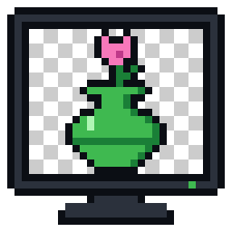
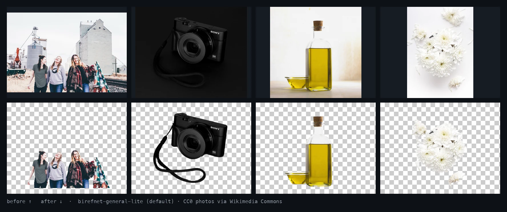

<p align="center">
  <picture>
    <source media="(prefers-color-scheme: dark)" srcset="assets/logo-dark.svg">
    
  </picture>
</p>

<h1 align="center">bulk-bg-remove</h1>

<p align="center"><em>Every photo in the folder. No background. Nothing leaves your machine.</em></p>

<p align="center">
  
  
  
</p>

<p align="center">
  
</p>

<p align="center">
  <strong>11 models benchmarked on 80 hard images, judged blind at zoom.</strong><br>
  The default scored <strong>8.6/10 on real product catalogue photos</strong>, the best of the 11, at <strong>3.2 s per photo</strong> on a laptop CPU.<br>
  <sub>Apple M5, CPU only, one worker. Method and every score: <a href="skills/bulk-bg-remove/references/models.md">models.md</a>.</sub>
</p>

> **Pre-release.** Not on PyPI yet; the install lines below go live with v0.1.

## What it is

An agent skill plus the engine behind it. Ask your coding agent to *"remove the
background from every photo in this folder"* and it:

1. installs the engine (one `uv tool install`, ~500 MB with Python),
2. checks your machine (free RAM, formats) and plans the run,
3. cuts out every image with BiRefNet, in a queue or in parallel depending on RAM and CPU,
4. verifies every output and tells you what worked, what failed and why.

Output goes to a new `<name>-no-bg/` folder next to the input. Originals are never
touched, and the subject's pixels are copied bit for bit: only the alpha channel is new.

Reads JPG, PNG, HEIC, WebP, AVIF, TIFF and BMP (by content, not extension), follows
EXIF rotation, and handles CMYK, 16-bit and 45 MP photos.

## Install

Any agent ([skills CLI](https://github.com/vercel-labs/skills)):

```bash
npx skills add Btike/bulk-bg-remove
```

<details>
<summary>Claude Code</summary>

```
/plugin marketplace add Btike/bulk-bg-remove
```
```
/plugin install bulk-bg-remove@bulk-bg-remove
```
</details>

<details>
<summary>Codex</summary>

```bash
codex plugin marketplace add Btike/bulk-bg-remove
codex plugin add bulk-bg-remove@bulk-bg-remove
```
</details>

<details>
<summary>Just the command, no agent</summary>

```bash
uv tool install bulk-bg-remove
bulk-bg-remove ~/Pictures/products          # → ~/Pictures/products-no-bg/
bulk-bg-remove                              # opens a drag-and-drop page in your browser
```
</details>

## Requirements

- macOS, Linux or Windows. CPU by default; CUDA with `onnxruntime-gpu`.
- About **11 GB of free RAM** for the default model. Less RAM works with lighter
  models; the agent picks one that fits and tells you the trade-off.
- The model downloads once (~220 MB). After that everything runs offline.

## Credits

Built on [rembg](https://github.com/danielgatis/rembg) and
[BiRefNet](https://github.com/ZhengPeng7/BiRefNet). Showcase photos (CC0, via
Wikimedia Commons): Priscilla Du Preez, Dennis Klein, margenauer, Hisu lee.

## License

MIT — see [LICENSE](LICENSE).
